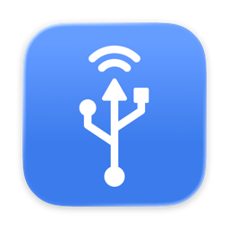

# usbip-macos

A [USB/IP](https://usbip.sourceforge.net/) client for macOS.

## Permissions

Attaching a device uses `IOUSBHostControllerInterface`, which needs one of:

- an app bundle signed with the `com.apple.developer.usb.host-controller-interface` entitlement and a provisioning profile that grants it (which I don't have yet)
- SIP disabled, running as root
- SIP disabled, the `amfi_get_out_of_my_way=1` boot-arg, and an ad-hoc signature claiming the entitlement: `codesign --force --sign - --entitlements entitlements.plist usbip.app`

## Usage

### Mac app

Opening `usbip.app` puts an icon in the menu bar. Add a server, then click an exported device to attach it and click it again to detach it.

### CLI

```sh
usbip-macos -r <server> list
sudo usbip-macos -r <server> attach --busid 1-1.4
```

The device stays attached until you stop the client.

## Limitations

- Isochronous devices (most webcams, microphones and speakers) don't work. This is a macOS limitation: `IOUSBHostControllerInterface` doesn't properly support isochronous transfers.
- UAS disks work, but only as plain mass storage. This is also a macOS limitation: `IOUSBHostControllerInterface` doesn't support the bulk streams UAS needs.
